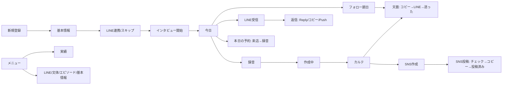
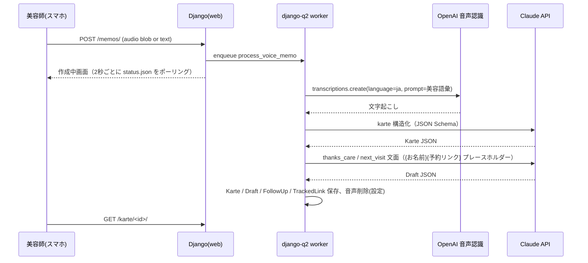
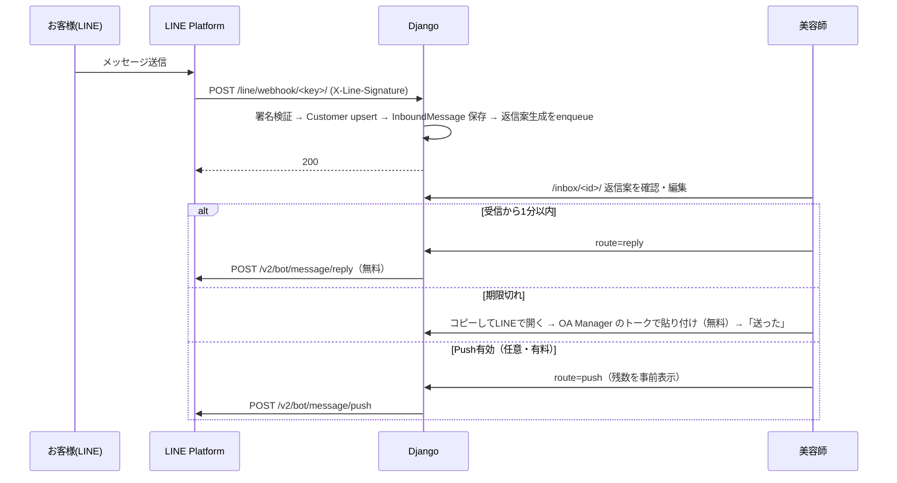

# TOMONI Beauty 第1段階（MVP）実装計画 兼 実装メモ

作成日: 2026-10-18 ／ 対象: 業務委託・面貸しの個人美容師向け Web アプリ（PWA）

> 指示書（tomoni-beauty-claude-code-prompt.md）では「計画 → 確認 → 実装」の順でしたが、
> 「最後まで実装する」という指示に従い、計画と実装を同時に進めました。本書は **計画書であり、同時に実装済みの内容の説明書** です。
> 判断が必要だった点は `docs/QUESTIONS.md` にまとめ、既定値で実装しています。

---

## 1. この段階で実装した範囲（指示書 6. 第1段階）

| # | 要件 | 実装 |
| --- | --- | --- |
| 1 | 美容師アカウント（マルチテナント） | `accounts.User`（メールログイン）＋ `accounts.Stylist`（テナント）。全業務モデルが `stylist` FK を持ち、ビューは `request.stylist` でフィルタ。他テナントのIDは404 |
| 2 | プロフィール音声インタビュー | 12問（`profiles.InterviewQuestion`）。1問ずつ録音 or テキスト → 文字起こし → Claude が人柄エピソード集（`Episode`）と文体の特徴を生成。追加・編集・使用履歴（`EpisodeUsage`） |
| 3 | 顧客の最小登録 | 名前・LINE紐付け・連絡可否・写真掲載可否・顔出し可否・ストーリー掲載可否（同意の更新日時を記録）。LINE友だち追加で自動作成 → 既存顧客に統合 |
| 4 | 音声メモ → 文字起こし → カルテ → 文面 | `karte.VoiceMemo` → Whisper系API → Claude 構造化 → `Karte` → お礼＋お手入れ案内・次回案内（`drafts.Draft`）→ フォロー予定（`visits.FollowUp`） |
| 5 | 唯一無二のSNS投稿 | 3要素ミックス（一般化した悩みと結果 / 許可済み写真 / エピソード）。目的選択。フィード・ストーリーズ・リール台本・ハッシュタグ。生成前の情報絞り込み＋生成後の個人情報チェック（正規表現＋LLM） |
| 6 | LINE個別連絡 | 「コピーしてLINEで開く」（無料）、Webhook受信 → 返信案 → Reply API（1分以内・無料）、期限切れはコピー方式へ、Pushは設定でオンの人だけ（残数表示）。ホットペッパー予約リンクはクリック計測付き |
| 7 | 次回フォローのリマインド | 「今日」画面にフォロー期日・返信待ち・送る文面・本日の予約を集約。日次バッチ（n8n/cron）で下書きを事前生成 |
| 8 | 案内送信 → 予約・来店の件数 | 予約は手入力。案内後14日以内の予約を帰属させて「案内後の予約 / 全予約」を月別表示。リンククリック数も集計 |

第2段階以降（一斉配信・リッチメニュー・予約メール取り込み・空き枠・経費・青色申告）は未実装。接続点を §9 に記載。

---

## 2. 技術スタックと選定理由

| 領域 | 採用 | 理由 |
| --- | --- | --- |
| バックエンド | Django 5.2 LTS | 指示どおり。LTS（2028年4月までサポート）。管理画面・認証・ORM・テストが揃い、1人で運用しやすい |
| DB | PostgreSQL（本番）／ SQLite（開発・テスト） | `DATABASE_URL` だけで切替。JSONField を多用するため Postgres が望ましい |
| 非同期処理 | django-q2（ORMブローカー） | 文字起こし＋生成で30〜60秒かかるため、リクエストから切り離す。Redis不要・`manage.py qcluster` 1プロセスで済む。開発時は `Q_SYNC=true` で同期実行 |
| AI | Anthropic Claude（`claude-opus-5-5`、構造化出力 `output_config.format`） | 指示どおり。JSON Schema で出力を固定しパース失敗を防ぐ。安全分類器による拒否時のサーバー側フォールバック（`fallbacks="default"`）を有効化。環境変数で Sonnet 等へ変更可 |
| 音声 | OpenAI 音声認識 API（既定 `gpt-4o-mini-transcribe`、$0.003/分） | Whisper系で日本語精度が高く、webm/mp4 両対応。`gpt-transcribe` にも切替可 |
| LINE | Messaging API（requests で直接呼び出し） | 公式SDKに依存せず、使うエンドポイントが5つ（reply/push/profile/info/quota）と少ないため |
| フロント | Django テンプレート＋素のCSS/JS、PWA（manifest / Service Worker） | ビルド工程なし。スマホ片手操作前提のボトムナビ・大きいタップ領域。MediaRecorder で録音、Clipboard API でコピー |
| 静的配信 | WhiteNoise | nginx 設定を最小化 |
| 自動化 | n8n（または cron） | 日次処理の起動とメール通知。第2段階の予約メール取り込みも n8n 想定 |
| インフラ | さくらVPS（Ubuntu）＋ gunicorn ＋ nginx ＋ systemd、GitHub Actions で SSH デプロイ | 指示どおり。`deploy/` にスクリプトと unit ファイル |

---

## 3. ディレクトリ構成

```
tomoni-beauty/
├── manage.py
├── config/              settings.py（環境変数で切替）, urls.py, test_settings.py
├── apps/
│   ├── core/            共通: テナント基底, 日付計算(dates.py), 「今日」画面・実績(services.py), 日次タスク, PWA, 内部API
│   ├── accounts/        User / Stylist, サインアップ・ログイン・オンボーディング・設定・削除・エクスポート
│   ├── ai/              Claude クライアント(claude_client.py), プロンプト(prompts.py), スキーマ(schemas.py),
│   │                    文字起こし(transcription.py), 個人情報チェック(pii.py), 呼び出し層(services.py)
│   ├── profiles/        StylistProfile(文体), InterviewQuestion/Answer, Episode, EpisodeUsage, エピソード選択
│   ├── customers/       Customer(同意フラグ・LINE紐付け), Tag, LINE仮顧客の統合
│   ├── visits/          Reservation, Visit, FollowUp, 帰属ロジック(services.py)
│   ├── karte/           VoiceMemo, Karte, KartePhoto, 処理パイプライン(services.py)
│   ├── drafts/          Draft(LINE文面), SnsPost, 生成・送信可否・SNS安全処理(services.py)
│   └── lineapp/         LineChannel, InboundMessage, Message, TrackedLink, LinkClick, QuotaUsage,
│                        Webhook, Reply/Push 送信, 通数(quota.py), LINE API クライアント(client.py)
├── templates/           画面テンプレート（アプリ別ディレクトリ）, base.html, _form.html
├── static/              css/app.css, js/app.js(コピー→LINE・ポーリング), js/recorder.js(録音), icons/
├── docs/                PLAN.md(本書), HOTPEPPER.md, LINE.md, QUESTIONS.md, DEPLOY.md
├── deploy/              setup_server.sh, deploy.sh, systemd/, nginx/
├── n8n/                 daily_digest_workflow.json
├── .github/workflows/   ci.yml（テスト）, deploy.yml（main への push で SSH デプロイ）
├── conftest.py, pytest.ini, requirements.txt, requirements-dev.txt, .env.example
```

各アプリは `models.py` → `services.py`（業務ロジック・テスト対象） → `views.py`（薄い）→ `tasks.py`（django-q2 から呼ぶ関数）の構成です。

---

## 4. データモデル（ER）

```mermaid
erDiagram
    User ||--|| Stylist : "1:1"
    Stylist ||--o| StylistProfile : 文体設定
    Stylist ||--o| LineChannel : LINEチャネル
    Stylist ||--o{ Customer : 顧客
    Stylist ||--o{ Episode : 人柄エピソード
    Stylist ||--o{ InterviewAnswer : インタビュー回答
    InterviewQuestion ||--o{ InterviewAnswer : ""
    InterviewAnswer ||--o{ Episode : 由来
    Episode ||--o{ EpisodeUsage : 使用履歴
    SnsPost ||--o{ EpisodeUsage : ""
    Customer ||--o{ Tag : "M:N"
    Customer ||--o{ VoiceMemo : 音声メモ
    VoiceMemo ||--o| Karte : 構造化
    Customer ||--o{ Karte : カルテ
    Karte ||--o{ KartePhoto : 施術写真
    Karte ||--o{ Draft : LINE文面
    Karte ||--o{ SnsPost : SNS投稿
    Karte ||--o{ FollowUp : フォロー予定
    FollowUp ||--o| Draft : 次回案内の下書き
    Customer ||--o{ Reservation : 予約
    Reservation ||--o| Visit : 来店
    Customer ||--o{ InboundMessage : 受信(Webhook)
    InboundMessage ||--o{ Draft : 返信案
    Customer ||--o{ Message : 送信ログ
    Draft ||--o{ Message : ""
    Message }o--o| TrackedLink : 予約リンク
    TrackedLink ||--o{ LinkClick : クリック
    Message ||--o{ Reservation : "帰属(attributed_message)"
    LineChannel ||--o{ QuotaUsage : 月次通数
```

主要フィールド（指示書8のたたき台からの変更点）:

- `Customer`: `call_name`（LINEでの呼び方）、`needs_review`（LINEから自動作成）、`consent_updated_at`、`line_blocked_at` を追加。
- `Karte`: `private_notes`（SNSに絶対使わない私的メモ）、`permission_mentions`（メモ内の掲載許可の言及→顧客設定への反映提案）を追加。
- `Draft`: 種別 `thanks_care / next_visit / reply / custom`、`generated_body`（AI原文に戻せる）、`scheduled_for`、`tracked_link`。
- `Message`: 送信ルート `copy / reply / push` と種別。`consumed_quota` は Push のみ true。
- `SnsPost`: `uses_story`、`generalized_story`（一般化後）、`pii_check`（結果JSON）、`episode`、`photos`。
- `QuotaUsage`: 月ごとの `quota_limit`・`total_usage`（LINE API取得値、管理画面からの配信分も含む概算）・`local_push_count`。
- 第2段階のモデル（Broadcast, AvailabilitySlot, IncomeStatement, Receipt, Expense, JournalEntry）は未作成。

---

## 5. 画面一覧（スマホ）と遷移

ボトムナビ: **今日** / **お客様** / **（録音）** / **LINE** / **メニュー**

| 画面 | URL | 役割 |
| --- | --- | --- |
| ログイン / 新規登録 | `/accounts/login/` `/accounts/signup/` | メール＋パスワード。`SIGNUP_ENABLED=false` で招待制 |
| オンボーディング 1/2/3 | `/accounts/onboarding/basic|line|interview/` | 基本情報・ホットペッパーURL → LINEチャネル（スキップ可）→ インタビュー開始 |
| 今日 | `/` | 作成中メモ、返信待ちLINE、送る文面、フォロー期日、本日の予約、今月の数字、録音ボタン |
| 録音 | `/memos/new/` | 顧客選択（検索/新規）→ 録音 or テキスト → 送信 |
| 作成中 | `/memos/<id>/` | 進行状況をポーリング。失敗時は再実行 |
| カルテ | `/karte/<id>/` | カルテ内容、文面一覧、写真（掲載可否）、SNS投稿作成、同意反映の提案、非公開メモ |
| 文面 | `/drafts/<id>/` | 編集（自動保存）→ コピーしてLINEで開く → 「送った」記録。Push（任意）。破棄 |
| SNS投稿作成 | `/sns/new/?karte=` | 目的・ストーリー使用・エピソード（自動提案）・写真選択 |
| SNS投稿 | `/sns/<id>/` | 個人情報チェック結果、フィード/タグ/ストーリーズ/リール各コピー、修正→再チェック、投稿済み記録 |
| LINE受信 | `/inbox/` `/inbox/<id>/` | 返信待ち一覧、返信案、Reply（残り秒数）/コピー/Push、対応不要 |
| お客様 | `/customers/` `/customers/<id>/` | 一覧・検索、詳細（同意トグル、カルテ、やりとり、予約）、編集、LINE仮顧客の統合、削除 |
| 予約・来店 | `/reservations/` `/visits/new/` | 手入力登録、来店化→録音へ、キャンセル |
| フォロー予定 | `/followups/` | 期日・今後・完了、見送り |
| 実績 | `/stats/` | 月別: 案内数（ルート別）、案内後予約/全予約、来店、クリック、SNS投稿 |
| メニュー・設定 | `/settings/...` | 基本情報、LINE連携（Webhook URL・接続確認・通数・Push）、文体、エピソード、インタビュー、エクスポート、削除 |



---

## 6. 外部API連携の設計

### 6.1 音声メモの処理（Whisper系 → Claude）



- iOS Safari は `audio/mp4`、Android Chrome は `audio/webm;codecs=opus` を `MediaRecorder.isTypeSupported` で判定し、拡張子を合わせて送信（どちらも API が受け付ける）。
- 文字起こし完了後、音声ファイルは既定で削除（`DELETE_AUDIO_AFTER_TRANSCRIPTION`）。
- APIキーが無い環境では `FakeAIClient` / `FakeTranscriber` が動くので、UIとテストは外部API無しで完結。

### 6.2 LINE Messaging API



- チャネル情報は美容師ごと（`LineChannel`）。Webhook URL は `/line/webhook/<ランダムキー>/` で、署名はそのチャネルのシークレットで検証。
- `GET /v2/bot/info` で `userId`（チャット画面URLに使用）・`basicId` を取得して接続確認。
- 通数: `GET /v2/bot/message/quota` と `/quota/consumption` を日次と手動で取得（管理画面からの配信も含む概算）。Push前に残数を確認し、超過なら送信不可。
- ホットペッパー予約リンクは `/r/<code>/` の計測リンクに置換（クリック数を実績に表示）。
- 詳細・調査結果は `docs/LINE.md`。

### 6.3 Claude API

- すべて `output_config.format = json_schema` の構造化出力。スキーマは `apps/ai/schemas.py`。
- システムプロンプトは固定文（`apps/ai/prompts.py`）、可変情報は user 側に置き、`cache_control` でプロンプトキャッシュを有効化。
- `stop_reason == "refusal"` は `AIRefusal` としてユーザーに日本語で通知。`fallbacks="default"`（beta `server-side-fallback-2026-07-01`）で安全分類器の誤判定時に別モデルへ自動フォールバック（環境変数で無効化可）。
- 7タスク: `karte`（構造化）/ `drafts`（LINE文面）/ `generalize`（悩みの一般化）/ `sns` / `pii_check` / `episodes` / `reply`。

---

## 7. SNS投稿生成のプロンプト設計

### 7.1 3要素のミックス

```
入力（build_sns_inputs がホワイトリストで組み立て）
  purpose          投稿の目的（指名 / 平日昼 / 初めての方 / 再来店 / 指定なし）
  story_allowed    uses_story かつ customer.story_ok かつ悩み/結果がある場合のみ true
  story            一般化済み {concern, result}（story_allowed のときだけ）
  treatment_summary / design_details   施術内容（常に可）
  episode          select_episode() が選んだ1件 {title, body, themes}
  style            文体設定（一人称・語尾・絵文字量・NGワード・参考文・話し方の特徴）
  photo_count      添付される写真の枚数（写真の中身は送らない）
  area_tags        地域ハッシュタグ
```

- **エピソード選択（コード側・決定論的）**: テーマ一致（施術メニュー・悩み語との部分一致）×3 ＋ 目的に合うテーマ、直近14日に使ったものは −10、使用回数が多いほど減点。→ 同じ話が続かない。
- 出力: `feed_text`（300〜500字、ハッシュタグ別）、`story_text`（40〜80字）、`reel_script`（[0-3秒] 形式）、`hashtags`（10〜15個）。
- 禁止表現（成果保証・批判・医療断定・捏造）はシステムプロンプトで明示。

### 7.2 個人情報の除去手順（3層）

1. **渡さない（ホワイトリスト）** — `Karte.sns_safe_fields()` が返す `concerns / results / treatment_summary / design_details / menu_items` だけが候補。顧客名・`private_notes`・`customer_requests`・顧客メモ・来店日時は構造上渡らない（テスト `test_inputs_exclude_private_notes_and_customer_identity`）。
2. **一般化** — `story_ok` の顧客のみ、悩みと結果を Claude で「同じ悩みを持つ多くの人が自分のことだと感じる粒度」に書き換え（名前・年齢・職業・居住地・家族・ライフイベント・時期表現を除去）。結果に顧客名が残っていればコード側で置換。
3. **生成後チェック** — 正規表現層（`apps/ai/pii.py`）: 顧客名の表記ゆれ（姓/名/読み/呼び名/LINE表示名）、年齢、電話、メール、郵便番号、LINE ID は **error**。「○○さん」や私生活ワードは **warning**。さらに Claude による二重チェック（`pii_check`）。error が残る投稿は「投稿済み」にできない（修正→再チェック）。

---

## 8. 通数（LINE）に関する設計方針

- 既定ルートはすべて **無料**: 「コピーしてLINEで開く」（1対1チャット）、Reply API（Webhook受信から1分以内）。
- Push は `LineChannel.push_enabled` をオンにした美容師だけ。送信前に残数・超過を表示し、超過時は送信不可。送信ごとにローカル加算し、日次で API の実測値に同期。
- 一斉・セグメント配信は第2段階。`QuotaStatus.planned_messages(対象人数, 回数)` で「消費通数・残数・超過警告」を計算する純粋関数を先に用意済み（テスト済み）。

---

## 9. 実装の順番（実施済み）と第2段階への接続点

実施順: 設定・共通基盤 → アカウント/テナント → AI層（Fake含む） → プロフィール → 顧客 → 予約/来店/フォロー → カルテパイプライン → 文面/SNS → LINE → 画面 → テスト → デプロイ/ドキュメント。

第2段階に向けた接続点:

| 第2段階の機能 | 既にある土台 |
| --- | --- |
| 一斉・セグメント配信 | `Tag`、`Customer.preferred_timing`、`QuotaStatus`、`Message.Kind.BROADCAST`。Broadcast モデルと対象抽出・事前確認画面を追加 |
| リッチメニュー | Webhook の `postback` 受信は実装済み（ログのみ）。「予約する/相談する/キャンセル待ち」の postback 処理を追加 |
| 予約通知メールの取り込み | `Reservation.Source.EMAIL`、`customer_name_raw`（未照合）。n8n IMAP → `POST /internal/reservations/`（要実装）→ 名寄せ画面 |
| 空き枠 | `Stylist.weekly_slot_hours / avg_price / commission_rate` を入力済み |
| 経費・青色申告 | 新規アプリ `ledger` として追加（本MVPには含めない） |

---

## 10. テスト

`pytest`（`config.test_settings`、外部API無し・SQLite in-memory）。主な対象:

- 日付計算: 次回案内日（目安日−7日、来店翌日を下限、年またぎ）、月の境界・閏年
- 帰属: 14日ウィンドウの境界、最新優先、返信・失敗は除外、キャンセル予約は対象外
- 通数: 残数・超過・警告しきい値・従量プラン、通数＝回数×人数
- LINE: 署名検証、Webhook（顧客自動作成・重複排除・follow/unfollow）、Replyトークン期限、Reply/Push 送信とログ、Push オプトイン・残数チェック
- 送信ルール: 連絡NG・ブロック・同種7日以内・予約済みへの次回案内
- SNS安全: ホワイトリスト、ストーリー同意なし、名前混入の検知、再チェック、投稿済みブロック
- パイプライン: テキストメモ→カルテ→文面→フォロー、失敗時の状態、他テナント顧客の拒否
- 画面スモーク: 主要42URLが200で描画

---

## 11. 検証計画（指示書11）に対応するログ

| 指標 | 取得元 |
| --- | --- |
| 毎日開くか | アクセスログ（nginx）。必要なら `Stylist.last_seen_at` を追加 |
| 案内後の予約・来店数 | `Reservation.attributed_message`、`Visit`（実績画面の「案内後の予約 / 全予約」） |
| 初回→2回目の割合 | `Visit` を顧客ごとに集計（クエリ追加で対応可） |
| SNS投稿の継続数 | `SnsPost.posted_at` |
| 返信・投稿準備にかかる時間 | `VoiceMemo.created_at → processed_at`、`Draft.created_at → sent_at`、`SnsPost.created_at → posted_at` |
| 純粋な上乗せ効果の分離 | 帰属あり/なしの予約を別カウント。将来は「案内を出さない対照群」をタグで指定できるようにする |
